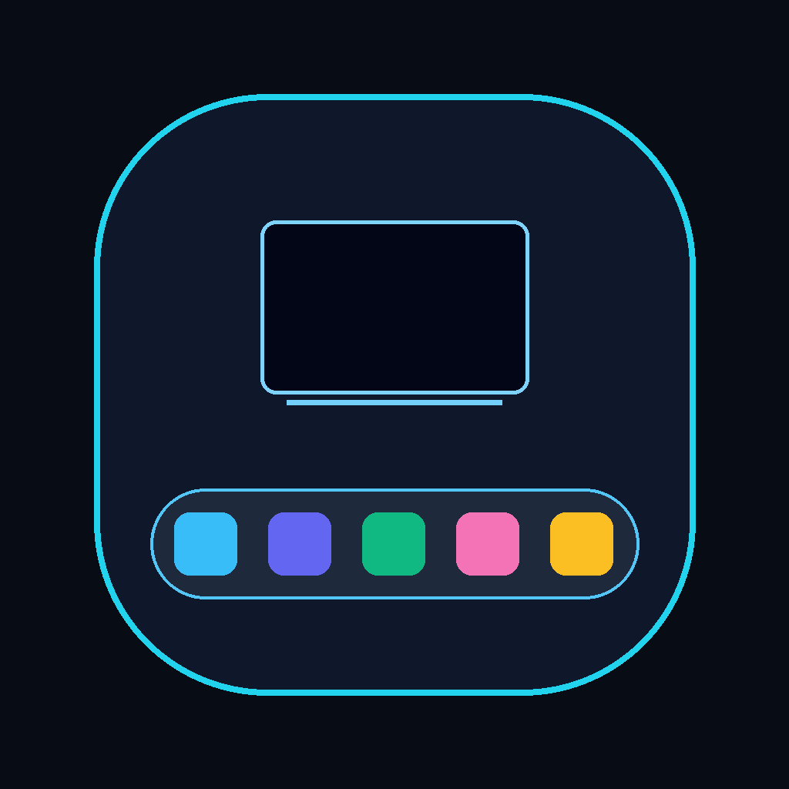
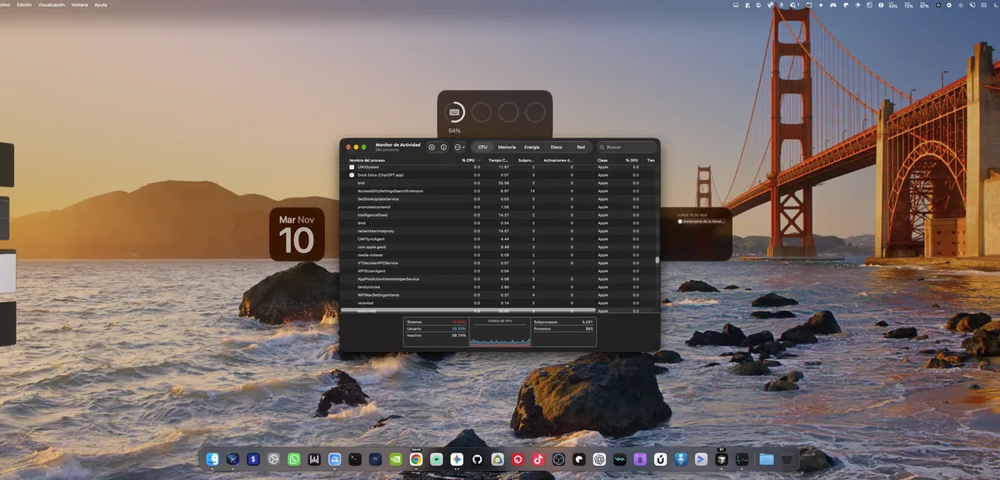

<div align="center">
  
  <br><br>
  <a href="https://stackdock.iareal.net/es/">Sitio web</a> ·
  <a href="https://stackdock.iareal.net/download/StackDock-4.0.5.dmg">Descargar</a> ·
  <a href="https://stackdock.iareal.net/es/#pricing">Precios</a> ·
  <a href="mailto:stackdock@iareal.net">Soporte</a>
  <br><br>
  <a href="README.md">🇬🇧 Read in English</a>
</div>

# 🖥️ StackDock

> Un Dock. Todas tus pantallas.

StackDock es una app de barra de menús para macOS que proyecta un Dock nativo de cristal esmerilado en cada pantalla conectada. También separa los perfiles de Chromium en iconos independientes y mueve ventanas entre monitores de forma proporcional, sin grabación de pantalla, cuentas en la nube ni captura de vídeo en segundo plano.

## ✨ ¿Por qué StackDock?

macOS ancla el Dock a una sola pantalla. Con monitores apilados, una pantalla inferior inclinada o un ultrawide, llegar al Dock obliga a cruzar pantallas y las ventanas acaban atrapadas en el monitor que no estás mirando.

StackDock mantiene un Dock sincronizado en cada pantalla, así que todas las apps siguen a un clic de distancia esté donde esté el puntero. Está construido sobre AppKit y notificaciones nativas de macOS, no sobre captura continua de pantalla: sin permiso de Grabación de Pantalla, sin búferes de vídeo 24/7 y sin nada ejecutándose cuando el Dock está oculto.

## 📲 Descarga

**[→ Descargar StackDock 4.0.5 para macOS](https://stackdock.iareal.net/download/StackDock-4.0.5.dmg)**

**Requisitos**

- macOS 13 Ventura o posterior
- Apple Silicon (M1–M4) o Intel — binario universal
- Permiso de Accesibilidad para mover ventanas y separar perfiles
- Acceso Completo al Disco (opcional) para leer nombres y avatares de perfiles de Chrome, Brave y Edge

El instalador está firmado con un Apple Developer ID y notarizado por Apple (Team ID `YH6W55MP95`).

Verifica el archivo antes de abrirlo:

```bash
shasum -a 256 ~/Downloads/StackDock-4.0.5.dmg
# 58e830794458be5e1a90dee1e020a0b540af209297aed2524003e7d31544c649
```

**Instalación**

1. Abre `StackDock-4.0.5.dmg`.
2. Arrastra **StackDock** a **Aplicaciones**.
3. Ábrelo. StackDock no tiene ventana principal: vive en la barra de menús.
4. Concede **Accesibilidad** cuando macOS lo solicite.
5. Pulsa `⌥ D` para mostrar los Docks.

**Prueba y precios**: prueba gratuita de 7 días con todas las funciones y sin tarjeta. Licencia Personal 9,99 USD (1 Mac); licencia Pro 19 USD (hasta 3 Macs). Política de reembolso de 14 días. Las licencias se verifican sin conexión, así que no hay cuenta, inicio de sesión ni servidor de activación.

## 🚀 Cómo funciona

1. **Instala y abre la app.** Abre el DMG, arrastra StackDock a Aplicaciones y ejecútalo. Aparecerá un icono en la barra de menús.
2. **Concede Accesibilidad.** macOS lo pedirá la primera vez que muevas una ventana o separes un perfil de navegador. Actívalo en *Ajustes del Sistema → Privacidad y seguridad → Accesibilidad*.
3. **Muestra los Docks.** Pulsa `⌥ D` (o `F12`, `⌃⌥ D`, `⌘⇧ D` — configurable) para mostrar u ocultar un Dock sincronizado en cada monitor seleccionado.
4. **Elige cómo convive con el Dock de Apple.** El modo *Solo StackDock* sustituye el Dock de Apple y lo mantiene oculto con retardo anti-apertura; el modo *Dual* deja ambos disponibles.
5. **Trabaja desde cualquier pantalla.** Haz clic para abrir o enfocar una app, clic en una app activa para ocultarla y usa el menú contextual para nuevas ventanas, perfiles y acciones de ventana.
6. **Separa tus navegadores.** Activa la separación de perfiles para obtener un icono por cada ventana de Chrome, Brave, Edge, Safari, Cursor o VS Code, con avatares y etiquetas de perfil.
7. **Mueve ventanas.** `Shift` + clic en un icono del Dock trae su ventana a la pantalla actual, redimensionada de forma proporcional. El atajo global (`⌃ W` por defecto) hace lo mismo con la ventana activa.
8. **Activa la licencia cuando quieras.** Abre el menú de la barra de menús → estado de la licencia → pega la clave `SDOCK-…` que recibiste por correo.

<p align="center">
  
</p>

## 📖 Guías

Todavía no hay un manual aparte: el sitio oficial funciona como documentación.

- [Estudio 3D interactivo](https://stackdock.iareal.net/es/#showcase-3d): gira una escena real de Mac mini + Studio Display y prueba los controles.
- [Arquitectura](https://stackdock.iareal.net/es/#story): cómo encajan el Dock nativo, la separación de perfiles y el teletransporte.
- [Rendimiento](https://stackdock.iareal.net/es/#benchmark): la comparativa propia del proyecto sobre CPU, memoria y permisos.
- [Capturas reales en M4](https://stackdock.iareal.net/es/#captures): imágenes de StackDock en hardware real.
- [Comparativa](https://stackdock.iareal.net/es/#compare): StackDock frente a los Dock que graban la pantalla.
- [Precios y preguntas frecuentes](https://stackdock.iareal.net/es/#pricing): licencias, prueba, reembolsos y dudas técnicas.
- [English site](https://stackdock.iareal.net/): la misma documentación en inglés.

Para ayuda de instalación, licencias o reembolsos, escribe a **stackdock@iareal.net**.

## 🔧 Funciones

**Dock multipantalla**

- Barra nativa `NSVisualEffectView` de cristal esmerilado dibujada en cada pantalla seleccionada.
- Docks replicados en todas las pantallas o aislamiento por monitor para que cada una muestre solo sus ventanas.
- Cuatro posiciones: abajo, abajo elevado (anti-cruce), arriba bajo la barra de menús y automático por monitor.
- Elige qué monitores dibujan un Dock, incluida la pantalla que ocupa el Dock de Apple.
- Modo Solo (sustituye el Dock de Apple) o Dual, con opción de ocultar el de Apple de forma sincronizada.
- Clic en una app activa para ocultarla; indicadores de ejecución en cada icono.
- Iconos de Descargas y Papelera con estado real y app configurable para abrirlos.
- Apertura automática al iniciar sesión (opcional).

**Perfiles y ventanas de navegador**

- Separa varias ventanas o perfiles en iconos propios para Chrome, Brave, Edge, Safari, Cursor y VS Code.
- Avatares y etiquetas de perfil, guardados en caché tras el primer permiso.
- Abre cualquier perfil directamente desde el menú contextual.
- Cierra solo ese perfil o ventana sin cerrar todo el navegador (clic con `⌥ ⌘`).
- Enfoca una ventana concreta cuando varias están agrupadas bajo una app.

**Teletransporte de ventanas**

- `Shift` + clic en cualquier icono del Dock mueve o trae su ventana a la pantalla actual, redimensionada de forma proporcional y sin recortes.
- Atajo global de movimiento con cuatro combinaciones (`⌃ W` por defecto).
- Envía la ventana activa a un monitor concreto desde el menú contextual.
- Pensado para monitores verticales apilados, pantallas inferiores inclinadas y configuraciones de cuatro pantallas.

**Privacidad y rendimiento**

- AppKit dirigido por eventos: sin ScreenCaptureKit, sin captura de vídeo continua y sin permiso de Grabación de Pantalla.
- El acceso a red se limita al feed oficial de actualizaciones; las licencias se verifican en el dispositivo. Sin telemetría ni cuentas.
- Un único binario universal en Swift (arm64 + x86_64), sin Electron ni runtimes de terceros.

**Actualizaciones y licencias**

- Feed de actualizaciones firmado con Ed25519 y verificado con una clave pública incrustada en la app.
- Comprobación de SHA-256 y de la lista de hosts permitidos antes de instalar una actualización.
- Actualizador integrado que sustituye la app mientras se ejecuta (4.0.5+).
- Activación sin conexión con claves `SDOCK-…`; la marca de tiempo de la prueba se replica en el Llavero para sobrevivir al borrado de preferencias.

## ❓ ¿Nuevo en GitHub?

Este repositorio no publica versiones en GitHub Releases. La build firmada y notarizada se distribuye desde el sitio oficial, así que no necesitas cuenta de GitHub, terminal ni Xcode:

1. Abre **[stackdock.iareal.net/es](https://stackdock.iareal.net/es/)**.
2. Pulsa **Descargar StackDock** (o usa el [enlace directo al DMG](https://stackdock.iareal.net/download/StackDock-4.0.5.dmg)).
3. Abre el `.dmg` descargado y arrastra **StackDock** a **Aplicaciones**.
4. Inicia la app y sigue los avisos de permisos.
5. Pulsa `⌥ D` para mostrar los Docks.

Si vienes a leer el código, empieza por `Sources/` para la app, `Web/` para la landing y `Scripts/` para el proceso de build y firma.

## 📙 Contribuir

StackDock es un producto comercial propietario. El repositorio es público como referencia y para dar transparencia a las versiones, pero no se aceptan contribuciones de código y el código no tiene licencia de reutilización.

Aun así puedes ayudar:

- **Errores y sugerencias:** escribe a **stackdock@iareal.net** con tu versión de macOS, modelo de Mac y configuración de pantallas.
- **Problemas de seguridad:** repórtalos por correo privado en lugar de abrir una incidencia pública.

## ❗ Acerca de

StackDock lo desarrolla **BLACK EYE** (Gabriel Dave) para quienes trabajan con configuraciones Mac apiladas, inclinadas o de varias pantallas. Versión actual: **4.0.5** (build 405), publicada el 12 de noviembre de 2026.

La app está construida íntegramente con frameworks de Apple — AppKit, atajos de Carbon, ApplicationServices/Accessibility, CryptoKit y ServiceManagement — y se distribuye como un único binario universal. No hay Electron, ni canal de vídeo en segundo plano, ni runtimes de terceros.

**Mapa del repositorio**

- `Sources/`: app de macOS con modelos, servicios, vistas y el controlador principal.
- `Web/`: landing bilingüe ES/EN con el estudio 3D, descargas y checkout.
- `Scripts/`: build local, DMG firmado y notarizado, generación de licencias y firma del feed de actualizaciones.
- `Automation/`: flujos de n8n para licencias de Stripe, onboarding de la prueba y envío de correos.

El estudio 3D del sitio se renderiza con Three.js; todo lo demás viaja dentro de la propia app.

## 📜 Licencia

StackDock es **software propietario**. Copyright © BLACK EYE. Todos los derechos reservados.

- Licencia **Personal**: 1 Mac. Licencia **Pro**: hasta 3 Macs.
- No se permite redistribuir la app, el instalador ni las claves de licencia.
- El código fuente de este repositorio se publica solo como referencia. **No** es open source y no se concede licencia para reutilizarlo, modificarlo ni redistribuirlo.
- El software se ofrece "tal cual" para uso personal o interno en las Mac autorizadas.

Los Términos del Servicio, la Política de Privacidad y la política de reembolso de 14 días están disponibles en el pie de página de [stackdock.iareal.net](https://stackdock.iareal.net/es/). Para dudas de licencias, escribe a **stackdock@iareal.net**.
