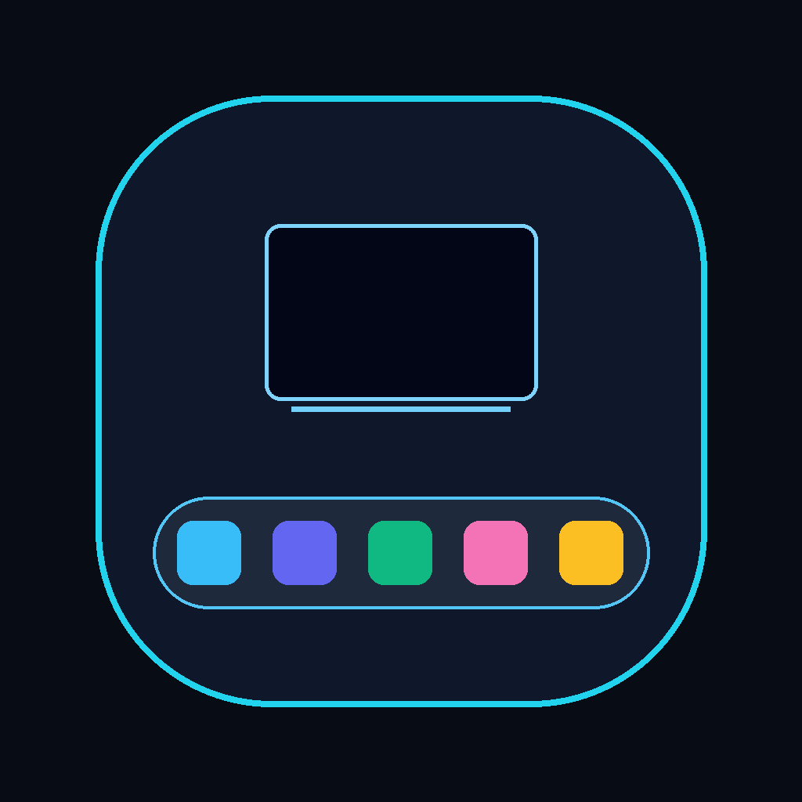
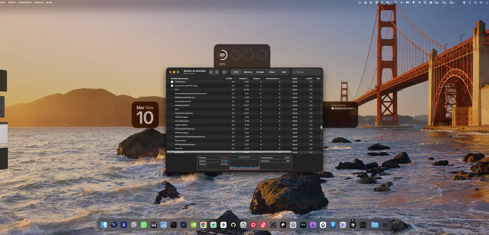

<div align="center">
  
  <br><br>
  <a href="https://stackdock.iareal.net">Website</a> ·
  <a href="https://stackdock.iareal.net/download/StackDock-4.0.5.dmg">Download</a> ·
  <a href="https://stackdock.iareal.net/#pricing">Pricing</a> ·
  <a href="mailto:stackdock@iareal.net">Support</a>
  <br><br>
  <a href="README.es.md">🇪🇸 Leer en español</a>
</div>

# 🖥️ StackDock

> One Dock. Every display.

StackDock is a menu-bar app for macOS that projects a native frosted-glass Dock onto every connected display. It also splits Chromium profiles into individual Dock icons and moves windows between monitors proportionally — without screen recording, cloud accounts or background video capture.

## ✨ Why StackDock?

macOS anchors the Dock to a single screen. On stacked monitors, angled lower displays or ultrawides, reaching for the Dock means crossing screens, and windows end up trapped on the display you are not looking at.

StackDock keeps a synchronized Dock on each screen, so every app stays one click away wherever the pointer is. It is built on AppKit and event-driven macOS notifications instead of continuous screen capture: no Screen Recording permission, no 24/7 video buffers, and nothing running in the background when the Dock is hidden.

## 📲 Download

**[→ Download StackDock 4.0.5 for macOS](https://stackdock.iareal.net/download/StackDock-4.0.5.dmg)**

**Requirements**

- macOS 13 Ventura or later
- Apple Silicon (M1–M4) or Intel Mac — universal binary
- Accessibility permission for window teleport and profile splitting
- Full Disk Access (optional) to read Chrome, Brave and Edge profile names and avatars

The installer is signed with an Apple Developer ID and notarized by Apple (Team ID `YH6W55MP95`).

Verify the file before opening it:

```bash
shasum -a 256 ~/Downloads/StackDock-4.0.5.dmg
# 58e830794458be5e1a90dee1e020a0b540af209297aed2524003e7d31544c649
```

**Install**

1. Open `StackDock-4.0.5.dmg`.
2. Drag **StackDock** into **Applications**.
3. Launch it. StackDock has no main window: it lives in the menu bar.
4. Grant **Accessibility** access when macOS asks for it.
5. Press `⌥ D` to show the Docks.

**Trial and pricing** — 7-day free trial with every feature unlocked and no credit card. Personal license $9.99 (1 Mac); Pro license $19 (up to 3 Macs). 14-day refund policy. Licenses are verified offline, so there is no account, sign-in or activation server.

## 🚀 How It Works

1. **Install and launch.** Open the DMG, drag StackDock to Applications and start it. A small icon appears in the menu bar.
2. **Grant Accessibility.** macOS will ask the first time you move a window or split a browser profile. Enable StackDock in *System Settings → Privacy & Security → Accessibility*.
3. **Summon the Docks.** Press `⌥ D` (or `F12`, `⌃⌥ D`, `⌘⇧ D` — configurable) to show or hide a synchronized Dock on every selected monitor.
4. **Pick a coexistence mode.** *Solo StackDock* replaces Apple's Dock and keeps it tucked in autohide with an anti-pop delay; *Dual* keeps both Docks available.
5. **Work from any screen.** Click to open or focus an app, click an active app to hide it, and use the context menu for new windows, profiles and window actions.
6. **Split your browsers.** Turn on profile separation to get one Dock icon per Chrome, Brave, Edge, Safari, Cursor or VS Code window, with profile avatars and labels.
7. **Move windows.** `Shift`-click a Dock icon to bring its window to the current display, proportionally resized. The global move hotkey (`⌃ W` by default) does the same for the active window.
8. **Activate when ready.** Open the menu-bar menu → license status → paste the `SDOCK-…` key you received by email.

<p align="center">
  
</p>

## 📖 Guides

There is no separate manual yet — the official site doubles as the documentation:

- [Interactive 3D Studio](https://stackdock.iareal.net/#showcase-3d) — rotate a live Mac mini + Studio Display scene and test the controls.
- [Architecture](https://stackdock.iareal.net/#story) — how the native Dock, profile splitting and teleportation fit together.
- [Performance](https://stackdock.iareal.net/#benchmark) — the project's own CPU, memory and permission comparison.
- [Real M4 captures](https://stackdock.iareal.net/#captures) — screenshots of StackDock on real hardware.
- [Comparison](https://stackdock.iareal.net/#compare) — StackDock versus video-capture Dock replacements.
- [Pricing and FAQ](https://stackdock.iareal.net/#pricing) — licenses, trial, refunds and technical questions.
- [Sitio en español](https://stackdock.iareal.net/es/) — the same documentation in Spanish.

For setup help, licensing or refunds, write to **stackdock@iareal.net**.

## 🔧 Features

**Multi-display Dock**

- Native `NSVisualEffectView` frosted-glass bar rendered on every selected display.
- Mirrored Docks everywhere, or per-monitor isolation so each screen only shows its own windows.
- Four placements: bottom, bottom elevated (anti-cross), top under the menu bar, and auto per monitor.
- Choose which monitors draw a Dock, including the display that holds Apple's Dock.
- Solo mode (replaces Apple's Dock) or Dual mode, with an option to hide Apple's Dock in sync.
- Click an active app to hide it; live running indicators on every tile.
- Downloads and Trash tiles with live Trash state and a configurable app to open them.
- Optional launch at login.

**Browser profiles and windows**

- Splits multiple windows or profiles into separate Dock icons for Chrome, Brave, Edge, Safari, Cursor and VS Code.
- Profile avatars and pill labels, cached locally after the first permission grant.
- Open any profile directly from the context menu.
- Close a single profile or window without quitting the whole browser (`⌥ ⌘`-click).
- Focus a specific window when several are grouped under one app.

**Window teleport**

- `Shift`-click any Dock icon to move or bring its window to the current display, resized proportionally with no clipping.
- Global move hotkey with four presets (`⌃ W` by default).
- Send the active window to a specific monitor from the context menu.
- Designed for stacked vertical monitors, angled lower displays and quad-display setups.

**Privacy and performance**

- Event-driven AppKit; no ScreenCaptureKit, no continuous video capture and no Screen Recording permission.
- Network access is limited to the official update feed; licenses are verified on-device. No telemetry and no accounts.
- Single universal Swift binary (arm64 + x86_64), with no Electron or third-party runtime.

**Updates and licensing**

- Ed25519-signed update feed verified with a public key embedded in the app.
- SHA-256 checksum and host allowlist checks before an update is installed.
- In-app updater replaces the app while it is running (4.0.5+).
- Offline activation with `SDOCK-…` keys; the trial timestamp is mirrored in the Keychain so it survives preference resets.

## ❓ New to GitHub?

This repository does not publish GitHub Releases. The signed, notarized build is distributed from the official website, so you do not need a GitHub account, a terminal or Xcode:

1. Open **[stackdock.iareal.net](https://stackdock.iareal.net)**.
2. Click **Download StackDock** (or use the direct [DMG link](https://stackdock.iareal.net/download/StackDock-4.0.5.dmg)).
3. Open the downloaded `.dmg` and drag **StackDock** into **Applications**.
4. Launch the app and follow the permission prompts.
5. Press `⌥ D` to bring up the Docks.

If you are here to read the source instead, start with `Sources/` for the app, `Web/` for the landing page and `Scripts/` for the build and signing pipeline.

## 📙 Contributing

StackDock is a proprietary commercial product. The repository is public for reference and release transparency, but source contributions are not accepted and the code is not licensed for reuse.

You can still help:

- **Bug reports and feature requests:** email **stackdock@iareal.net** with your macOS version, Mac model and display layout.
- **Security issues:** report them privately by email instead of opening a public issue.

## ❗ About

StackDock is developed by **BLACK EYE** (Gabriel Dave) for people working on stacked, angled and multi-display Mac setups. Current version: **4.0.5** (build 405), released November 12, 2026.

The app is built entirely with Apple frameworks — AppKit, Carbon hot keys, ApplicationServices/Accessibility, CryptoKit and ServiceManagement — and ships as a single universal binary. There is no Electron, no background video pipeline and no third-party runtime.

**Repository map**

- `Sources/` — macOS app: models, services, views and the app controller.
- `Web/` — bilingual EN/ES landing page with the 3D studio, downloads and checkout.
- `Scripts/` — local build, signed and notarized DMG, license generation and update-feed signing.
- `Automation/` — n8n workflows for Stripe licenses, trial onboarding and email delivery.

The website's 3D studio is rendered with Three.js; everything else ships with the app itself.

## 📜 License

StackDock is **proprietary software**. Copyright © BLACK EYE. All rights reserved.

- **Personal** license: 1 Mac. **Pro** license: up to 3 Macs.
- Redistribution of the app, the installer or license keys is not permitted.
- The source code in this repository is published for reference only. It is **not** open source and no license to reuse, modify or redistribute it is granted.
- The software is provided "as is" for personal or internal business use on authorized Macs.

The Terms of Service, Privacy Policy and 14-day refund policy are available from the footer of [stackdock.iareal.net](https://stackdock.iareal.net). For licensing questions, contact **stackdock@iareal.net**.
